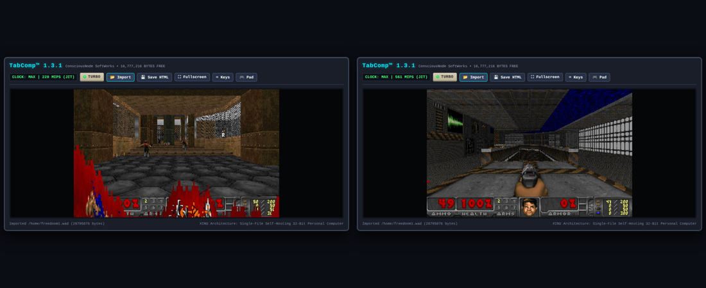

# Building and running DOOM on TabComp™ 1.3.1

TabComp builds the real DOOM engine itself: every C file is compiled by `/bin/c89` running on the TabComp CPU, and linked by `/bin/ld`. Nothing is precompiled, and no source file needs changing.



## What you need

- **doomgeneric**, the portable DOOM engine (GPL-2.0): https://github.com/ozkl/doomgeneric. You need the files in its `doomgeneric/` folder.
- **An IWAD.** [Freedoom](https://freedoom.github.io/) Phase 1 (`freedoom1.wad`, BSD licence) is free and works. The shareware `doom1.wad` works too, and so does your own copy of `doom.wad`.

## Steps

1. Boot TabComp 1.3.1.
2. Click **📂 Import** (or drag and drop onto the screen), and select every `.c` and `.h` file from doomgeneric's `doomgeneric/` folder, plus your WAD. They land in `/home`.
3. Build. `/src/doom/doom.rsp` lists the 80 engine files plus TabComp's platform layer, `/src/doom/doomgeneric_tabcomp.c`:

   ```
   c89 -DCMAP256 -DDOOMGENERIC_RESX=320 -DDOOMGENERIC_RESY=200 -I/home @/src/doom/doom.rsp -o /bin/doom
   ```

   This takes about 20–30 seconds with TURBO on, and makes `/bin/doom` (about 860 KB).
4. Run it: `doom`. It finds the WAD in `/home` by itself; to choose one, use `doom -iwad /home/doom1.wad`.

**Controls:** arrows or WASD to move, Ctrl or F to fire, Space or E to use, Enter for menus, Esc for the menu, Shift to run, 1–7 for weapons. Ctrl+C returns to the shell.

## Speed

Game time is always real time. At slower clocks DOOM draws fewer frames, the way it did on slow PCs. Here are figures from the real page loop on a desktop:

| Clock | Frames per second |
|---|---|
| TURBO | about 28 |
| `clock 200` | 34 (DOOM's cap is 35) |
| `clock 100` | 16 |
| `clock 50` | 8 |
| `clock 25` | 4 |

A DOOM frame costs about 6 million TabComp instructions.

## The platform layer

`/src/doom/doomgeneric_tabcomp.c` connects doomgeneric to TabComp:
- `DG_DrawFrame` copies the 320×200 frame to VRAM at `0x0F0000`, syncs the palette into palette RAM at `0x0FFA00` when DOOM changes it, and calls `YIELD`.
- `DG_GetKey` reads `KEYEVENT` (`SYS 27`).
- `DG_GetTicksMs` and `DG_SleepMs` use `TICKS_MS` and `SLEEP_MS`.
- `DG_PlaySound8` uses PCM.
- It also supplies `main()`.

## Licences

- TabComp is MIT.
- doomgeneric, and any program or cartridge built from it, is GPL-2.0. `export /bin/doom DOOM --gpl` writes the GPL notice and source pointer into the cartridge.
- A cartridge carries every `.wad` on the disk. If you share one with `freedoom1.wad` inside, include Freedoom's BSD licence notice.
- Never share a cartridge containing id Software's commercial WADs.

## How it was tested

`tests/doom.mjs` does all of the above headlessly and checks the result. See [TESTING.md](../TESTING.md) for the 12 bugs this turned up in 1.3, and what the C compiler still does not do.
